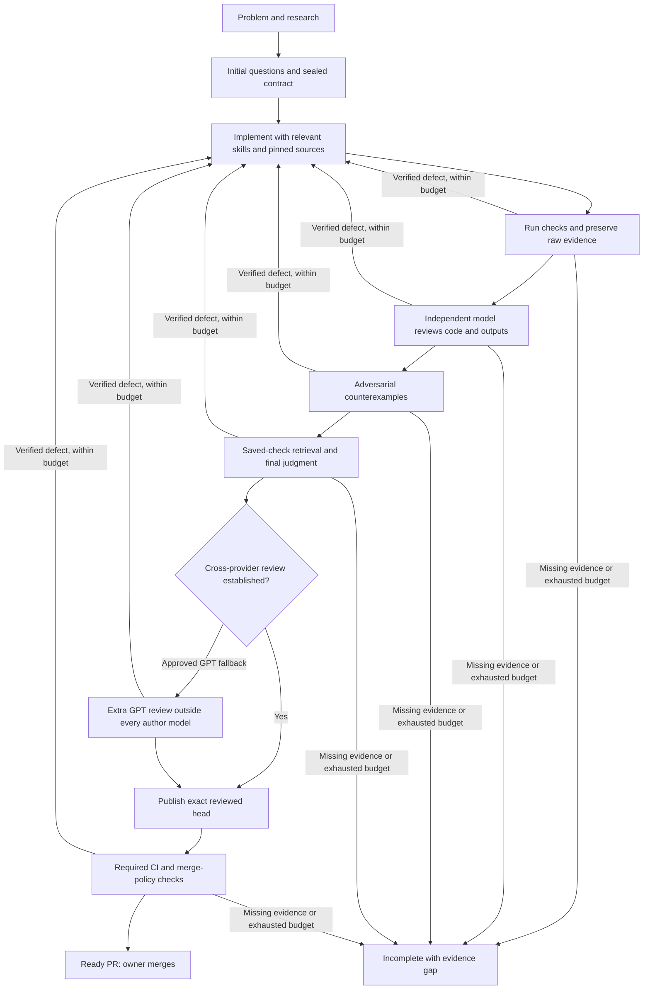

# Task harness

A first implementation of a local, persistent controller for task work through T3. The controller owns the sequence;
workers submit observations and evidence. Host shell access is trusted, not sandboxed.
Task state belongs outside the source checkout, under `~/.local/state/sovran-harness` by
default (`SOVRAN_HARNESS_STATE` overrides it). It contains private local evidence; do not
commit or publish the database or raw logs.

The JSON CLI and MCP server share one protocol, defined in `src/protocol.ts`.
Run `bun run harness request.json`, or pipe a request to `bun run harness -`.
`bun run harness mcp` serves the same operations over stdio using the official MCP SDK.
The controller never merges or deploys.

The [reliability research and proposed model policy](../docs/research/full-send-reliability.md)
define the next improvements. They distinguish approved choices from gates implemented here.

Use the repository's `full-send` skill from an existing T3 conversation. It performs the
initial multiple-choice intake and drives the JSON controller with T3-owned child tasks.
That works through the host when the conversation is viewed on an iPhone; no mobile build
or background iOS agent is installed. The MCP server is an optional interface, not an
automatically registered T3 extension. Its schema is discoverable through MCP `tools/list`.

## Sealed authority

Scope uses repository-relative files or directory prefixes, not globs. Dependency allowances
name exact `package@specifier` strings. Override/catalog/patch policy changes use the exact
`manifest:path#section=JSON` value; lockfile changes require `lockfile:path@sha256`.
Resolve planned dependency changes in a disposable preview before intake so the owner can
approve the resulting allowance. Unexpected dependency needs stop work without a mid-run
question. Deletions still have to satisfy scope and tests.

Context is copied before execution, with hashes. Per-role briefs point at existing skills,
including the navigation document's reason for `-flow` wrappers. They do not replace those
rules with another standards catalogue. Relevant external files are pinned by commit under
`/tmp/sovran-harness/references/<owner>/<repository>/<commit>` and copied into private task
evidence. A missing or dirty cache is refused, never silently reset. Upstream content is
reference material, not task authority. No upstream repositories are cloned until selected.
The [project catalog](src/references.ts) owns verified origins; already sealed snapshots keep
their recorded origin when the catalog changes.

PR authority pins repository, push URL, branch, base revision and required CI check names.
Publication needs a clean checkout at the tested source, starting from the sealed PR base.
Unknown outcomes reconcile the existing branch/PR and may repeat identical metadata updates.
A missing PR after an uncertain request does not authorize another
create. A base changing after verification invalidates integration evidence. The publisher
never force-pushes, merges, enables auto-merge, or deploys.

## What a transition proves

The initial contract records outcomes, scope, commands, models, allowed dependencies and
a deadline. Research precedes sealing. A worker must claim its exact ticket before submitting;
another worker cannot take over merely because time passed. Completion means that worker
and its child processes have stopped. Unknown outcomes require reconciliation, not replay.

Verification runs the agreed command arguments without a shell. Every command records its
output and the source fingerprint. A changed candidate invalidates evidence. Review and
adversarial review precede the final audit. An audit command completing is evidence only:
the audit worker must still judge it. The controller rejects skipped stages and missing
requirement observations. Qualitative judgments remain model judgments, not proofs.

Observations and findings must cite real repository files or registered, unchanged task
artifacts. Accepted research travels with its source and evidence identity into later briefs;
it describes what was learned before implementation, not proof about the changed candidate.
Independent reviewers receive that context without other reviewers' verdicts.

Reviewers must submit observations for the actual hashed command artifacts. No controller
can prove a model understood a log; this gate makes missing or stale evidence visible.
T3's coordinator verifies model identity and terminal child state from tool results; a role
brief is not a provider system prompt or a technical tool restriction. The typed
[model policy](src/models.ts) owns the initial model choices and effort. Its live-catalog
snapshot establishes advertised support, not availability or effective effort. These choices
are evaluation hypotheses, not a ranking proven for this repository.

Routed contracts authorize a finite ordered availability fallback. A replacement needs a
terminal worker and no live children; it keeps the deadline, source, failed evidence and
all prior authors. Unknown dispatch outcomes retain ownership. Dispatch reservation grants
one caller permission to launch; a replay must reconcile the existing attempt. Negative
reviews enter repair, never model shopping. Old single-target contracts gain no fallback.
If the provider definitively rejected creation, the coordinator records that exact request
and provider error instead of inventing a child. An empty lineage search is insufficient.

Normal reviews must include a non-GPT review and cover every source-author provider with
a different provider. Otherwise the approved fallback requires an extra fresh reviewer using
a GPT model outside every source-author model across attempts and repairs. Normal review,
adversarial review and audit remain required. Missing eligible
models end incomplete. The PR discloses model attempts, fallback and unreported effective effort.

The SQLite transaction stores the transition and outstanding action together. An interrupted
command remains pending. Restarting does not silently rerun it. Immutable artifact writes are
idempotent, and reusing an operation id with different input is rejected. The database has a
version; an unsupported version is preserved and refused rather than reset.

Normal termination and timeouts kill the check's POSIX process group. A host/process crash
can leave unknown work: `reconcile-command` only releases a recorded group once it no longer
exists, and ends incomplete. A crash before its identity was recorded stays unresolved.
Deliberately detached descendants and arbitrary host shell actions remain outside this
trusted-host boundary. Use one shared state directory for all coordinators; separate journals
cannot coordinate ownership. Existing competing prototype rows remain readable but prevent
new work until reconciled; they are never deleted to make a migration pass.

## Persistence and native evidence

All application/wallet changes conservatively trigger the existing historical upgrade suite.
This includes feature-owned storage, not only `app/shared`. The controller discovers the
epoch inventory and Coco database manifest and checks ordinary assertions for the recorded
facts. Expected failures, missing cases, unexpected skips and known loss metadata cannot pass.
Existing historical check inputs and the upgrade command cannot change within the task they
certify; settle changes to that baseline before sealing. This deliberately favors false blocks
over silently dropping an old version from the test population.

A passing unit gate is bounded fixture evidence, never certification of every reachable
Zustand, Redux-era, SecureStore or Coco state. The existing persistence skill and ledger own
the wider state-space argument, including interrupted operations, skipped releases, restore
combinations, account types and platform differences. The controller does not reimplement
wallet migrations or Cashu behavior. Current known losses make this gate inconclusive.

Functional UI and performance tasks currently stop incomplete: the existing story/scenario
results do not bind their session to an installed binary on both platforms. Build-bound
captures establish visual evidence, not functional success. The producer integration and
required device validation are tracked in [F156](../docs/follow-ups/F156.md). This first
version must not be presented as production-ready autonomous wallet development.

## Development

`bun run --cwd harness test` exercises real SQLite, temporary git repositories and subprocesses.
`bun run --cwd harness type-check` checks this tooling independently of the shipped app.
The publication tests use a temporary bare Git remote and a fake GitHub executable; they
do not establish live GitHub readiness. The remaining complete live T3/GitHub pilot is
tracked in [F157](../docs/follow-ups/F157.md). No real-wallet, native or funded scenarios are part
of the tooling tests. Source-backed design references are in the
[ADR](../app/docs/adr/2026-10-16-task-harness.md).
